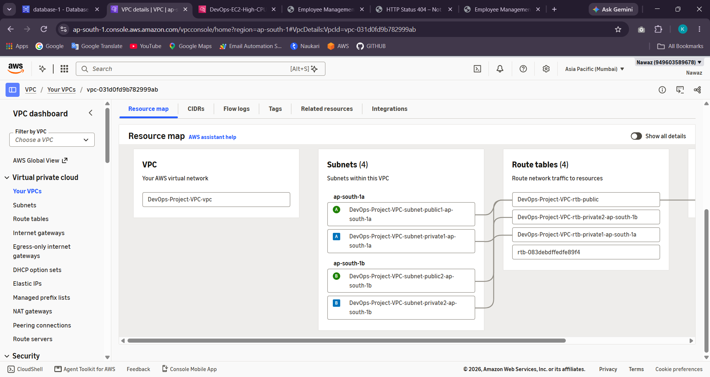
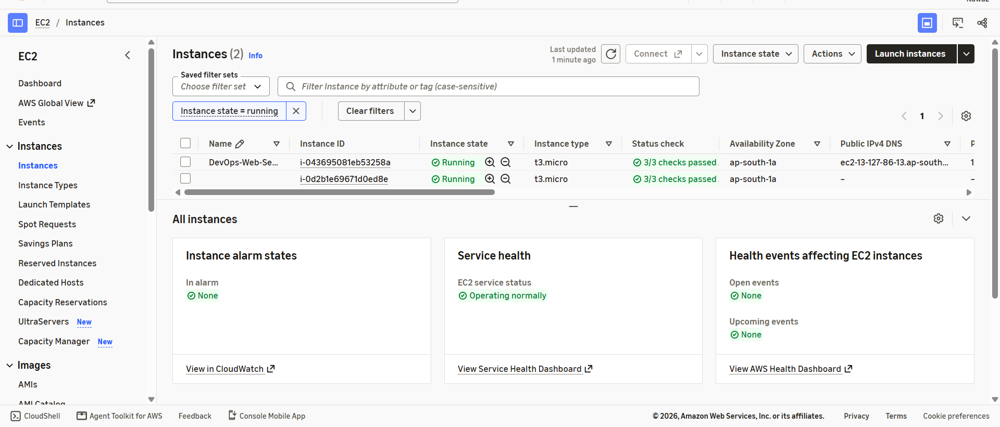
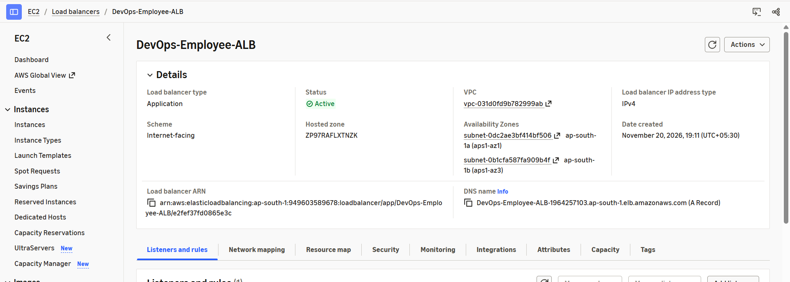
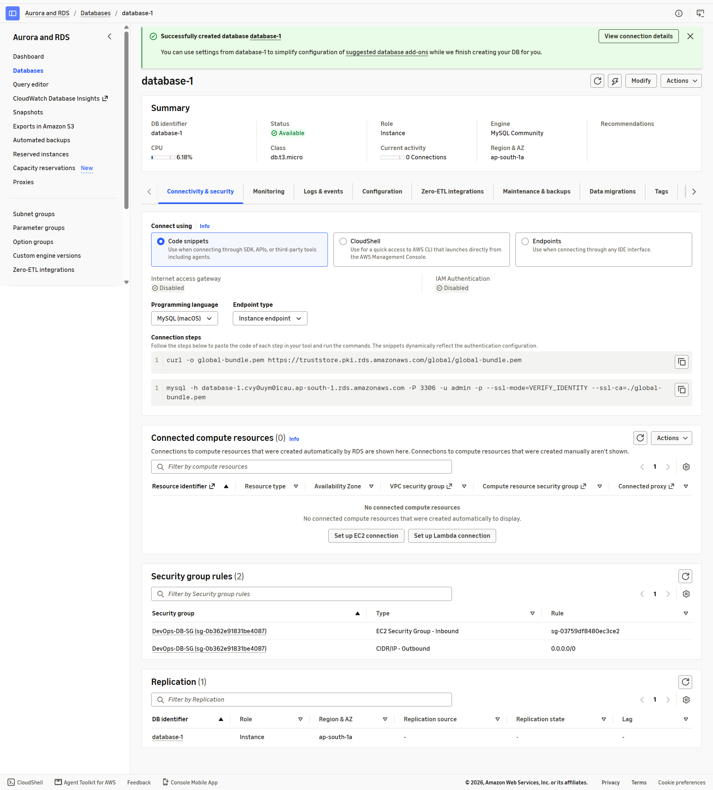
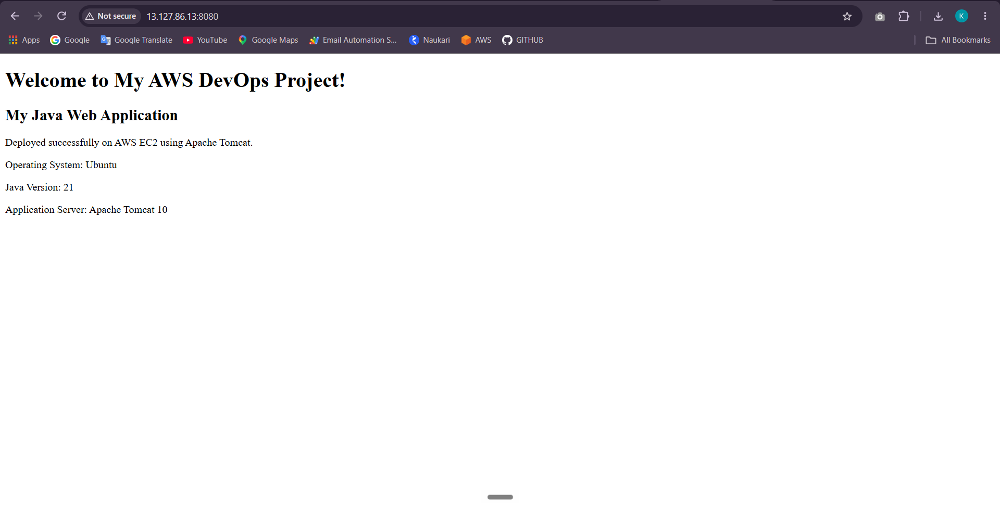
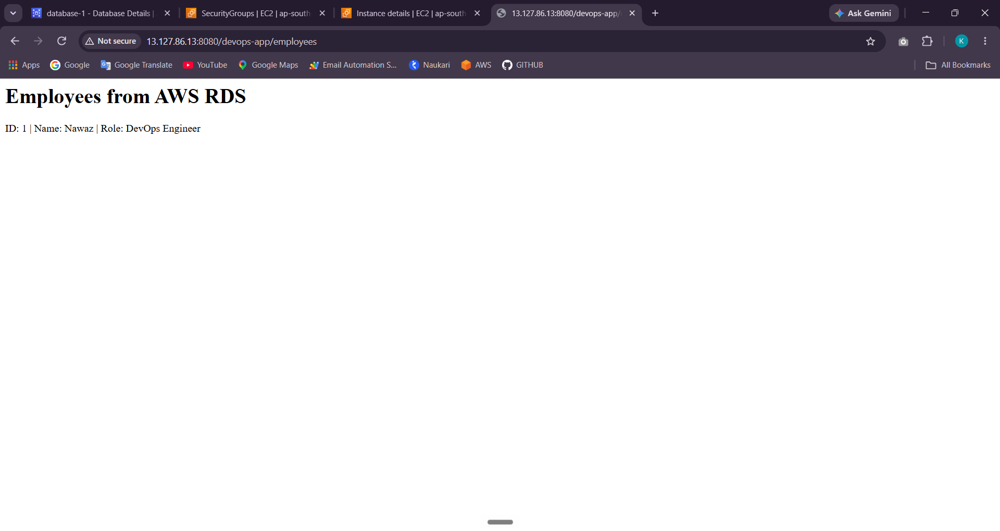
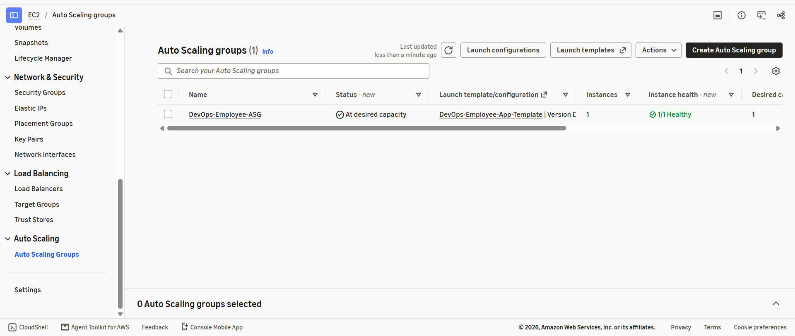
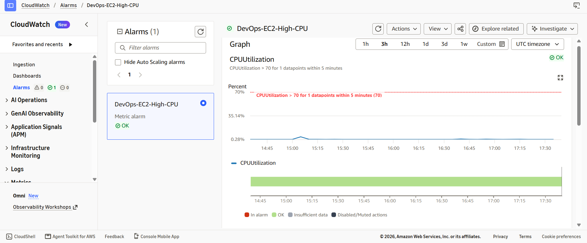
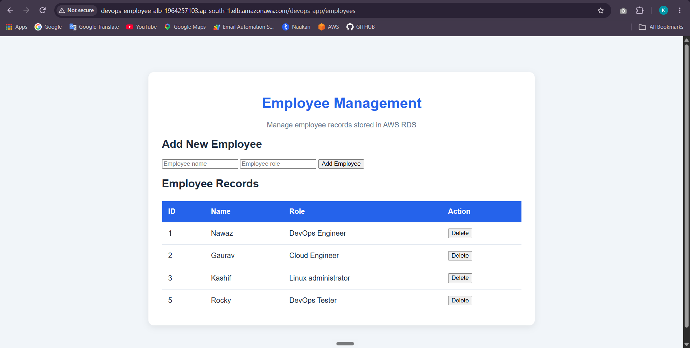

# AWS Three-Tier Employee Management Application

## 1. Project Overview

This project is a Java-based Employee Management Web Application deployed on AWS.

The main goal of this project is to understand how to deploy and manage a web application using different AWS services.

Users can view, add, and delete employee records. Employee information is stored in an AWS RDS MySQL database.

## 2. Project Architecture

The application works in three main layers:

1. **Web Layer:** Application Load Balancer receives incoming user requests.
2. **Application Layer:** Amazon EC2 runs the Java application using Apache Tomcat.
3. **Database Layer:** Amazon RDS MySQL stores employee information.

### How It Works

1. A user opens the application through the Load Balancer URL.
2. The Load Balancer forwards the request to an EC2 instance.
3. Apache Tomcat runs the Java application.
4. The Java application connects to the RDS MySQL database.
5. Employee records are displayed to the user.

## 3. AWS Services Used

| AWS Service | Purpose |
|---|---|
| VPC | Created an isolated network for the project. |
| EC2 | Hosted the Java web application. |
| Application Load Balancer | Distributed incoming traffic to EC2 instances. |
| RDS (MySQL) | Stored employee information. |
| Auto Scaling Group | Managed EC2 instance capacity. |
| S3 | Stored and accessed project files. |
| IAM | Managed permissions for AWS resources. |
| CloudWatch | Monitored EC2 CPU utilization. |

## 4. Technologies Used

- Java
- Java Servlets
- Apache Tomcat 10.1
- MySQL
- Ubuntu Linux
- HTML
- AWS Cloud

## 5. Application Features

- View employee details.
- Add new employee records.
- Delete employee records.
- Store employee information in MySQL.
- Access the application through the Load Balancer.

## 6. Application URL

The application can be accessed using the Application Load Balancer:

`http://<ALB-DNS-NAME>/devops-app/employees`

Replace `<ALB-DNS-NAME>` with your Load Balancer DNS name.

## 7. Database Configuration

The application uses Amazon RDS MySQL to store employee records.

Database connection details are configured using environment variables:

- `DB_URL` – Database connection URL.
- `DB_USER` – Database username.
- `DB_PASSWORD` – Database password.

**Security:** Database passwords and private connection details are not included in this repository.

## 8. Project Screenshots

### AWS Infrastructure

**VPC Configuration**

**EC2 Instances**

**Application Load Balancer**

**RDS Database**

### Application Deployment

**Web Application Deployment**

**Successful Application Result**

### Monitoring and Scaling

**Auto Scaling Group**

**CloudWatch Monitoring**

### Employee Management Application

## 9. What I Learned

Through this project, I gained practical experience in:

- Creating and configuring a custom AWS VPC.
- Launching and managing EC2 instances.
- Deploying a Java application on Apache Tomcat.
- Connecting an application to an RDS MySQL database.
- Configuring an Application Load Balancer.
- Implementing EC2 Auto Scaling.
- Monitoring resources using CloudWatch.
- Managing AWS permissions using IAM.

## 10. Conclusion

This project helped me understand how different AWS services work together to host a web application.

It gave me practical exposure to AWS infrastructure, application deployment, networking, database connectivity, monitoring, and basic DevOps concepts.

---

**Project Type:** Cloud & DevOps Hands-on Project  
**Application:** Employee Management System  
**Platform:** Amazon Web Services (AWS)
